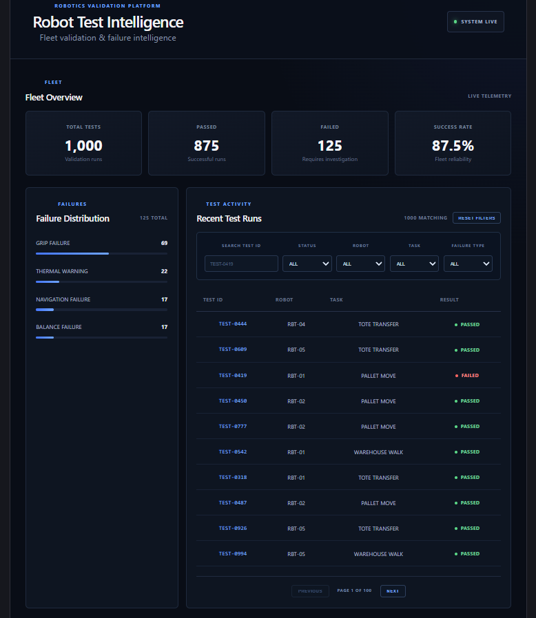
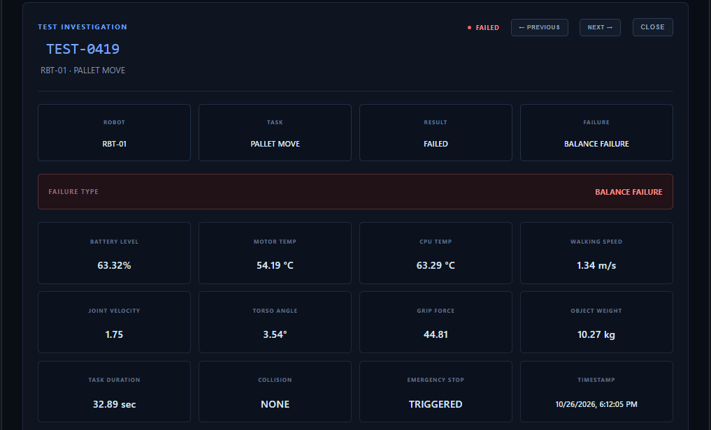
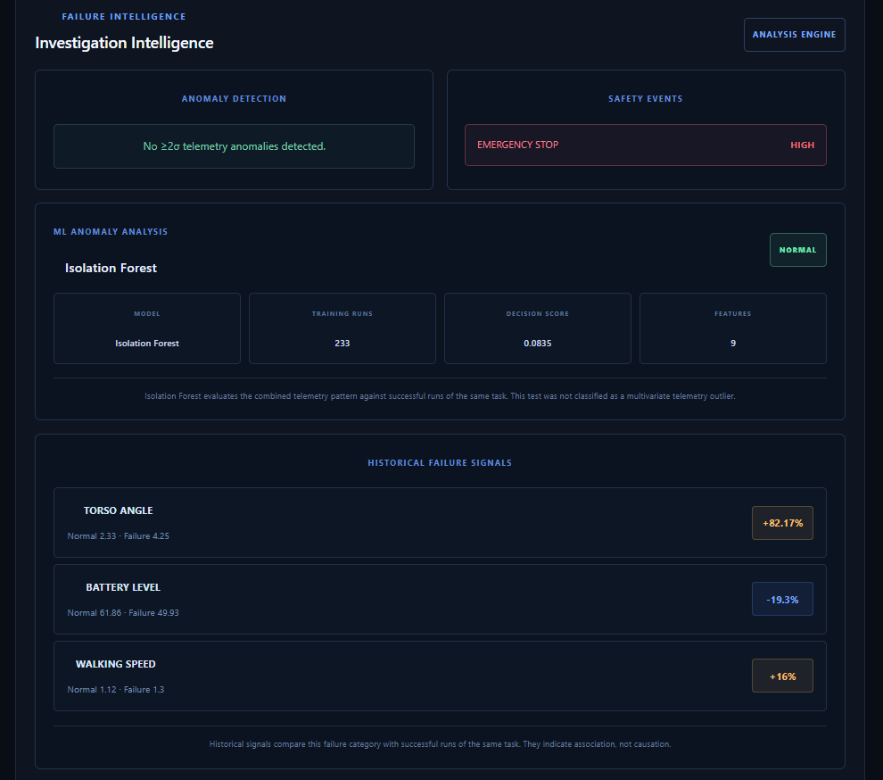
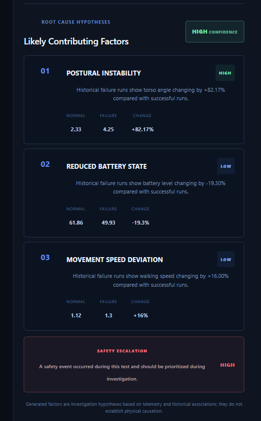
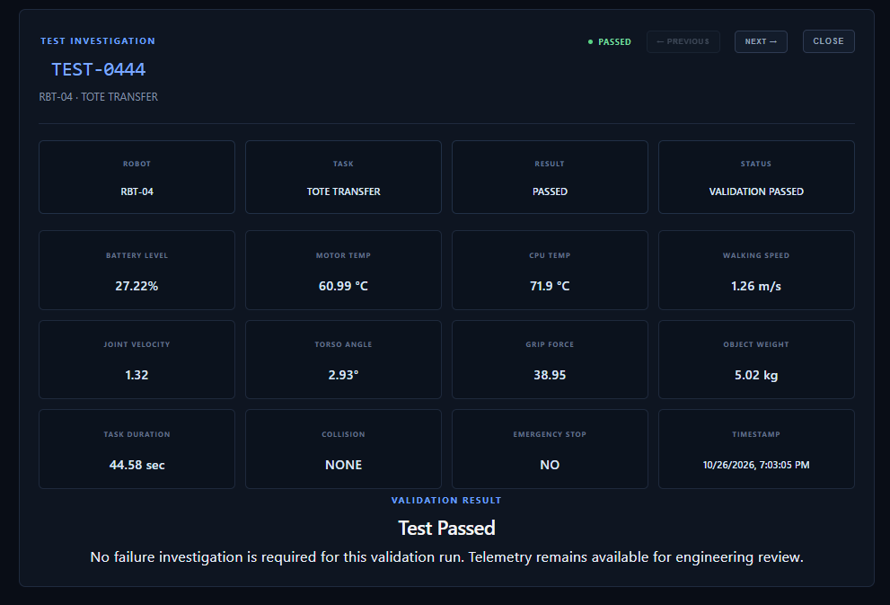
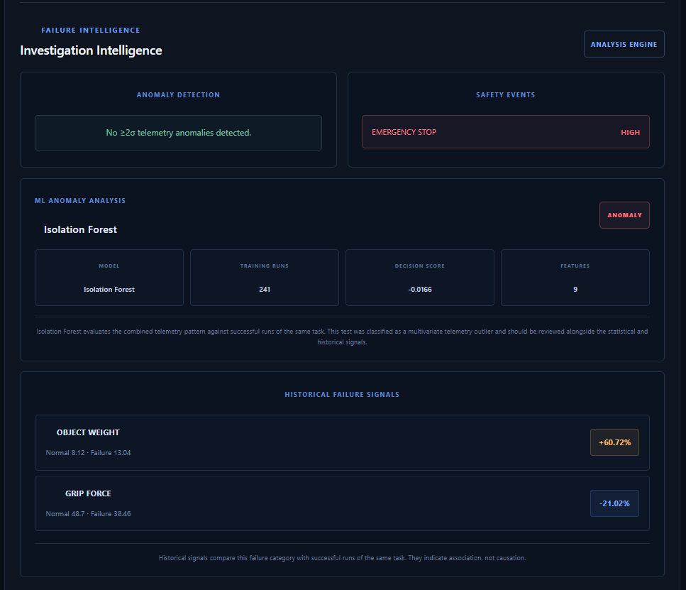

# Robot Test Intelligence

AI-assisted robot validation and failure investigation platform for analyzing robot test telemetry, detecting anomalous behavior, comparing historical failure patterns, and generating explainable investigation hypotheses.

The project combines a **React + TypeScript engineering dashboard**, a **FastAPI backend**, statistical anomaly detection, historical failure analysis, and an **Isolation Forest machine-learning model** to help engineers investigate robot validation runs.

---
## Dashboard Preview



## Overview

Robot validation systems can produce large amounts of telemetry across hundreds or thousands of test runs.

Finding a failed test is easy.

Understanding **why it failed, what telemetry was unusual, whether similar failures share patterns, and what an engineer should investigate next** is much harder.

Robot Test Intelligence was built to provide that investigation layer.

The platform allows engineers to:

- Monitor robot validation runs
- Search and filter fleet test history
- Inspect individual telemetry values
- Detect statistical telemetry anomalies
- Detect multivariate anomalies using machine learning
- Compare failure categories against successful runs
- Identify safety events
- Generate explainable root-cause hypotheses
- Navigate efficiently between test investigations

---

## Architecture

```mermaid
flowchart TD
    A[Synthetic Robot Telemetry] --> B[CSV Dataset]

    B --> C[FastAPI Backend]

    C --> D[Statistical Anomaly Detection]
    C --> E[Isolation Forest ML Detection]
    C --> F[Historical Failure Analysis]
    C --> G[Safety Event Analysis]

    D --> H[Failure Investigator]
    E --> H
    F --> H
    G --> H

    H --> I[Root-Cause Hypothesis Engine]

    I --> J[Investigation REST API]

    J --> K[React + TypeScript Dashboard]

    K --> L[Fleet Explorer]
    K --> M[Telemetry Investigation]
    K --> N[ML Anomaly Analysis]
    K --> O[Root-Cause Hypotheses]

## Core Features

### Fleet Overview

The dashboard provides fleet-level validation metrics including:

- Total test runs
- Passed tests
- Failed tests
- Success rate
- Failure distribution

---

### Fleet Test Explorer

Engineers can search and filter robot tests by:

- Test ID
- Result
- Robot ID
- Task type
- Failure type

The explorer also supports:

- Pagination
- Matching-result counts
- Reset filters
- Selected-row highlighting

---

### Test Investigation

Clicking a test opens detailed telemetry including:

- Battery level
- Motor temperature
- CPU temperature
- Walking speed
- Joint velocity
- Torso angle
- Grip force
- Object weight
- Task duration
- Collision detection
- Emergency stop state
- Timestamp

Engineers can also move between neighboring test runs using:

```text
PREVIOUS TEST ←   → NEXT TEST
```

---

## Statistical Anomaly Detection

The platform builds a task-specific baseline using successful runs.

For each telemetry feature, the system calculates:

- Mean
- Standard deviation
- Z-score

The current rule identifies a statistical anomaly when:

```text
|z-score| >= 2
```

This allows the system to answer:

> Was an individual telemetry measurement unusually far from normal behavior?

---

## Machine-Learning Anomaly Detection

The platform also includes an **Isolation Forest** anomaly detector using scikit-learn.

The model is trained on successful runs of the same task type and analyzes the combined telemetry pattern across nine features:

```text
battery_level
motor_temperature
cpu_temperature
walking_speed
joint_velocity
torso_angle
grip_force
object_weight
task_duration
```

Unlike the Z-score detector, Isolation Forest evaluates telemetry features together.

This can identify unusual operating states even when no individual feature exceeds a statistical threshold.

Example:

```text
TEST-0419
Task: PALLET_MOVE
Prediction: NORMAL
Decision Score: 0.0835
```

Another example:

```text
TEST-0039
Task: OBJECT_PICK
Prediction: ANOMALY
Decision Score: -0.0166
```

A failed test is not automatically considered an ML anomaly.

The model evaluates whether its telemetry pattern is unusual relative to successful runs.

---

## Historical Failure Analysis

For failed tests, the system compares telemetry from a failure category against successful runs of the same task.

Example:

```text
BALANCE_FAILURE
Task: PALLET_MOVE

Torso Angle
Normal: 2.33
Failure: 4.25
Change: +82.17%

Battery Level
Normal: 61.86
Failure: 49.93
Change: -19.30%

Walking Speed
Normal: 1.12
Failure: 1.30
Change: +16.00%
```

This answers a different question from anomaly detection:

> What telemetry patterns tend to appear when this type of failure occurs?

---

## Root-Cause Hypothesis Engine

Historical signals are converted into explainable investigation hypotheses.

Example:

```text
POSTURAL INSTABILITY
Confidence: HIGH
Change: +82.17%

REDUCED BATTERY STATE
Confidence: LOW
Change: -19.30%

MOVEMENT SPEED DEVIATION
Confidence: LOW
Change: +16.00%
```

Current rule-based confidence thresholds:

```text
Absolute Change >= 50%      HIGH
Absolute Change >= 20%      MEDIUM
Absolute Change >= 10%      LOW
Absolute Change < 10%       Ignored
```

The platform intentionally describes these results as **investigation hypotheses**, not proven physical causes.

Historical association does not establish causation.

---

## Safety Event Analysis

Safety events are evaluated separately from telemetry.

Examples include:

```text
EMERGENCY_STOP
Severity: HIGH
```

A safety event can increase the overall investigation priority even when telemetry values are not individually anomalous.

---

## Example Investigation

### TEST-0419

```text
Robot: RBT-01
Task: PALLET_MOVE
Result: FAILED
Failure Type: BALANCE_FAILURE
```

Analysis:

```text
Statistical anomaly detection:
No >=2 sigma telemetry anomalies

ML anomaly detection:
Isolation Forest -> NORMAL

Historical failure signals:
Torso Angle   +82.17%
Battery       -19.30%
Walking Speed +16.00%

Safety event:
EMERGENCY_STOP -> HIGH

Likely contributing factor:
POSTURAL INSTABILITY -> HIGH

Investigation confidence:
HIGH
```

This example demonstrates why multiple analysis methods are useful.

A test may fail even when:

- no single telemetry feature crosses the Z-score threshold
- the ML model does not classify the entire telemetry pattern as an outlier

Historical failure patterns and safety signals may still provide valuable investigation evidence.

---

## Technology Stack

### Frontend

```text
React
TypeScript
Vite
CSS
```

### Backend

```text
Python
FastAPI
Pandas
```

### Machine Learning / Analytics

```text
scikit-learn
Isolation Forest
StandardScaler
Z-score anomaly detection
Statistical failure comparison
Rule-based hypothesis generation
```

### Development

```text
Git
GitHub
REST APIs
Virtual Environments
```

---

## Project Structure

```text
robot-test-intelligence/
│
├── backend/
│   ├── app/
│   │   └── main.py
│   └── requirements.txt
│
├── data/
│   └── raw/
│       └── robot_test_runs.csv
│
├── frontend/
│   ├── src/
│   │   ├── App.tsx
│   │   ├── App.css
│   │   └── main.tsx
│   ├── package.json
│   └── vite.config.ts
│
├── ml/
│   ├── anomaly_detection/
│   │   ├── detector.py
│   │   └── isolation_forest_detector.py
│   │
│   └── failure_analysis/
│       ├── analyzer.py
│       ├── investigator.py
│       └── hypothesis_engine.py
│
├── scripts/
│   └── generate_telemetry.py
│
├── .gitignore
└── README.md
```

---

## API Endpoints

### Service Status

```http
GET /
```

---

### Fleet Summary

```http
GET /api/summary
```

Returns:

- Total tests
- Passed tests
- Failed tests
- Success rate
- Failure breakdown

---

### Search Test Runs

```http
GET /api/tests
```

Supported parameters:

```text
page
page_size
search
result
robot_id
task_type
failure_type
```

Example:

```text
/api/tests?page=1&page_size=10&result=FAILED&robot_id=RBT-01&task_type=PALLET_MOVE
```

---

### Get Individual Test

```http
GET /api/tests/{test_id}
```

Example:

```text
/api/tests/TEST-0419
```

---

### Generate Investigation

```http
GET /api/investigate/{test_id}
```

Example:

```text
/api/investigate/TEST-0419
```

Returns:

- Statistical anomalies
- ML anomaly analysis
- Safety events
- Historical failure signals
- Root-cause hypotheses
- Investigation confidence

---

## Running the Project Locally

### 1. Clone the Repository

```bash
git clone <your-repository-url>
cd robot-test-intelligence
```

---

### 2. Create Python Virtual Environment

Windows:

```powershell
python -m venv .venv
.venv\Scripts\activate
```

macOS/Linux:

```bash
python -m venv .venv
source .venv/bin/activate
```

---

### 3. Install Backend Dependencies

```bash
pip install -r backend/requirements.txt
```

---

### 4. Start FastAPI

From the project root:

```bash
uvicorn backend.app.main:app --reload
```

Backend:

```text
http://127.0.0.1:8000
```

Swagger API documentation:

```text
http://127.0.0.1:8000/docs
```

---

### 5. Install Frontend Dependencies

Open another terminal:

```bash
cd frontend
npm install
```

---

### 6. Start React

```bash
npm run dev
```

Frontend:

```text
http://localhost:5173
```

---

## Generate Synthetic Telemetry

The repository includes a synthetic robot telemetry generator.

Run:

```bash
python scripts/generate_telemetry.py
```

The generated dataset contains robot validation runs across tasks such as:

```text
PALLET_MOVE
OBJECT_PICK
WAREHOUSE_WALK
TOTE_TRANSFER
```

---

## Engineering Decisions

### Why use successful runs as the baseline?

Successful runs provide a reference for expected robot behavior.

This prevents known failure behavior from being incorporated into the definition of normal operation.

---

### Why use both Z-score and Isolation Forest?

They solve different problems.

Z-score detection evaluates individual telemetry features.

Isolation Forest evaluates the combined multivariate telemetry pattern.

Using both provides more investigation context than relying on one technique.

---

### Why not call historical signals proven root causes?

A relationship between telemetry and failures does not prove physical causation.

Therefore the platform uses terms such as:

```text
Likely Contributing Factor
Investigation Hypothesis
Historical Association
```

instead of claiming that a signal definitively caused a failure.

---

### Why task-specific baselines?

Different robot tasks can have different normal operating ranges.

Comparing `PALLET_MOVE` against unrelated tasks could create misleading anomaly results.

Therefore analysis is performed relative to successful runs of the same task.

---

## Screenshots

### Fleet Dashboard


### Failed Test Investigation



### ML Normal + Historical Analysis



### Root-Cause Hypotheses



### Passed Validation



### ML Anomaly Detection



---

## Future Improvements

Potential future extensions include:

- Persistent database storage
- Streaming telemetry ingestion
- Time-series anomaly detection
- Robot-specific baselines
- Failure trend visualization
- Model persistence and offline training
- Authentication and role-based access
- Real robot telemetry integration
- Automated investigation reports
- Deployment monitoring
- Model performance evaluation

---

## Project Status

```text
Version: 1.0
Status: Portfolio-ready prototype
```

The current implementation demonstrates an end-to-end robot validation intelligence workflow from telemetry ingestion through machine-learning-assisted failure investigation.

---

## Author

**Somu Medaka**

Software Engineer | Full-Stack Development | AI/ML | Cloud